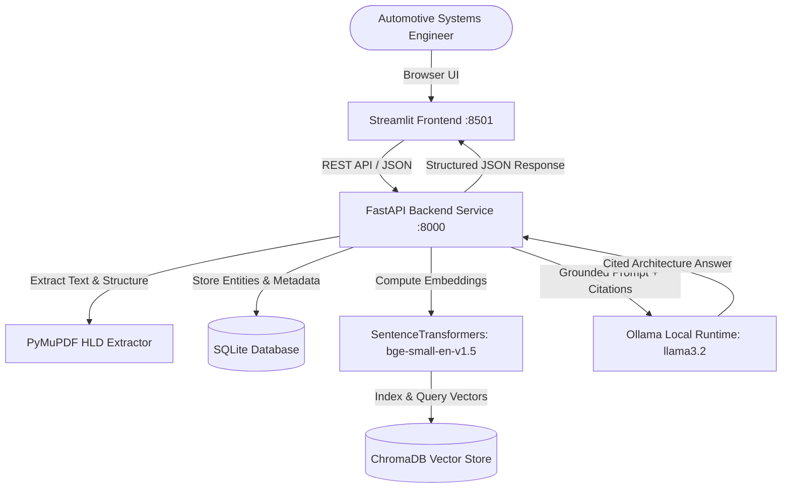

# 🚗 AUTOSAR HLD Document Analysis Assistant

A local-first, privacy-compliant AI platform developed for automotive systems architects, embedded software developers, and integration engineers to ingest, trace, compare, and validate **AUTOSAR High-Level Design (HLD)** specifications.

---

## 📌 Executive Summary & Problem Statement
AUTOSAR HLD documents are multi-hundred-page specifications detailing Software Components (SWCs), ports, interfaces, signals, and functional data flows. Reviewing these documents manually causes:
- **Information Overload:** Tracing signals across complex interface hierarchies is tedious and error-prone.
- **Traceability Gaps:** Mapping a sensor signal (e.g. `VehicleSpeed`) to downstream controllers (e.g. `BrakeControlSWC`, `EngineControlSWC`) requires manual page hunting.
- **Inconsistency Risks:** Unassigned require-ports, dangling signals, and mismatched data types slip into implementation stages.
- **IP & Security Concerns:** Cloud-based commercial LLMs cannot be used due to confidential vehicle architecture IP.

The **AUTOSAR HLD Document Analysis Assistant** solves these challenges by combining **local vector retrieval (ChromaDB + `bge-small-en-v1.5`)**, **local LLM reasoning (Ollama `llama3.2`)**, structured **SQLite metadata persistence**, and heuristic **static architecture validation**.

---

## 🏗️ System Architecture



---

## 🚀 Core Features

| Feature | Description | Status |
|---|---|---|
| **📄 HLD PDF Ingestion** | Uploads multi-page AUTOSAR HLD specifications, extracts text, headings, and structure via PyMuPDF. | **Verified** |
| **🧠 Contextual Chunking & Embeddings** | Generates 384-dim normalized vector embeddings using `BAAI/bge-small-en-v1.5` and persists them in ChromaDB. | **Verified** |
| **💬 Semantic RAG Question Answering** | Answers queries with strict Section and Page citations using local Ollama (`llama3.2`). | **Verified** |
| **🧩 Entity Extraction** | Automatically catalogs Software Components (SWCs), Provide/Require Ports, Interfaces, and Signals in SQLite. | **Verified** |
| **🔄 Revision Comparison (Diff Engine)** | Compares two HLD document versions (e.g. v2.0 vs v2.1) to flag added, modified, and removed entities. | **Verified** |
| **⚠️ Architecture Inconsistency Validation** | Heuristic static audit for unassigned require-ports, dangling signals, and data type mismatches with ISO 26262 ASIL-D recommendations. | **Verified** |

---

## 📂 Project Structure

```
RAG_Project/
├── backend/
│   └── app/
│       ├── config.py                 # Pydantic Settings & environment config
│       ├── database.py               # SQLAlchemy engine & SQLite session
│       ├── main.py                   # FastAPI app entrypoint & lifespan
│       ├── models/
│       │   └── schema.py             # ORM: Project, Document, Chunk, AutosarEntity, AuditLog
│       ├── schemas/
│       │   └── api_models.py         # Pydantic request & response schemas
│       ├── services/
│       │   ├── pdf_parser.py         # PyMuPDF extractor with section detection
│       │   ├── chunker.py            # Contextual chunking preserving page metadata
│       │   ├── vector_store.py       # ChromaDB vector store & bge-small-en-v1.5
│       │   ├── rag_engine.py         # Grounded RAG with Ollama & citations
│       │   ├── entity_extractor.py   # AUTOSAR components, ports, interfaces, signals
│       │   ├── diff_engine.py        # Revision comparison diff engine
│       │   └── validation_engine.py  # Architectural mismatch & inconsistency auditor
│       └── routes/
│           ├── upload.py             # /api/upload & /api/upload/sample
│           ├── query.py              # /api/query
│           ├── entities.py           # /api/entities
│           ├── compare.py            # /api/compare
│           ├── validate.py           # /api/validate
│           ├── projects.py           # /api/projects
│           ├── documents.py          # /api/documents
│           └── health.py             # /api/health
├── frontend/
│   ├── app.py                        # Streamlit multi-tab application
│   └── components/
│       ├── api_client.py             # FastAPI REST client
│       └── ui_helpers.py             # Automotive theme CSS & citation cards
├── data/
│   ├── sample_hlds/                  # Sample AUTOSAR HLD PDFs (v2.0 & v2.1)
│   ├── uploads/                      # Uploaded documents
│   └── vector_db/                    # ChromaDB persistence storage
├── docs/                             # Full architectural documentation suite
│   ├── PRD.md                        # Product Requirements Document
│   ├── Architecture.md               # Software Architecture Document
│   ├── implementation_plan.md        # Phased 8-stage roadmap
│   ├── README_Documentation.md       # Project delivery summary
│   ├── Project_Feature_guide.pdf     # Original feature guide
│   └── word_originals/               # Preserved Microsoft Word (.docx) files
├── tests/
│   ├── test_pdf_parser.py            # PDF parser unit tests
│   ├── test_chunker.py               # Chunker unit tests
│   ├── test_entity_extractor.py      # Entity extraction unit tests
│   ├── test_validation_and_diff.py   # Validation and diff engine unit tests
│   └── test_api_endpoints.py         # FastAPI endpoint integration tests
├── scripts/
│   ├── generate_sample_hld.py        # Generates synthetic HLD test PDFs
│   ├── run_backend.bat               # Windows batch launcher for backend
│   └── run_frontend.bat              # Windows batch launcher for frontend
├── pytest.ini                        # Pytest configuration
├── requirements.txt                  # Dependency manifest
├── run.py                            # All-in-one launcher
└── README.md                         # Main documentation
```

---

## ⚡ Quickstart & Setup Guide

### 1. Prerequisites
- **Python 3.10+** (Tested on Python 3.14)
- **Ollama** installed with `llama3.2:latest` model:
  ```bash
  ollama run llama3.2:latest
  ```

### 2. Install Dependencies
```bash
pip install -r requirements.txt
```

### 3. Generate Sample AUTOSAR Documents (Optional)
Pre-generated sample specifications are included in `data/sample_hlds/`. To regenerate:
```bash
python scripts/generate_sample_hld.py
```

### 4. Run the Application
Launch both Backend and Frontend simultaneously:
```bash
python run.py
```
Or launch individually:
- **Backend Only (FastAPI):**
  ```bash
  python -m uvicorn backend.app.main:app --host 127.0.0.1 --port 8000 --reload
  # or run scripts/run_backend.bat
  ```
- **Frontend Only (Streamlit):**
  ```bash
  python -m streamlit run frontend/app.py --server.port 8501
  # or run scripts/run_frontend.bat
  ```

Access the interfaces:
- **Streamlit Web UI:** [http://localhost:8501](http://localhost:8501)
- **FastAPI Interactive Docs:** [http://127.0.0.1:8000/docs](http://127.0.0.1:8000/docs)

---

## 🧪 Running the Test Suite
The test suite validates parsing, chunking, entity extraction, vector retrieval, revision diffing, and API health:
```bash
python -m pytest -v
```

All 8 automated unit and integration tests pass cleanly.

---

## 🎯 Step-by-Step Demonstration Walkthrough

1. **Dashboard & Status:**
   - Open [http://localhost:8501](http://localhost:8501). Observe the **Backend: Online** and **LLM: Connected** indicators in the sidebar.
2. **Ingest Baseline HLD (v2.0):**
   - Click **"Load v2.0 (Base)"** in the sidebar. PyMuPDF parses the document, creates chunks, extracts entities, and embeds them into ChromaDB.
3. **Ingest Target Revision (v2.1):**
   - Click **"Load v2.1 (Target)"** in the sidebar.
4. **Ask a Semantic RAG Query:**
   - Go to the **💬 Semantic RAG Assistant** tab.
   - Click the preset: *"Identify the port receiving VehicleSpeed."*
   - Click **Execute Tracing Query**.
   - Notice the grounded response:
     > `VehicleSpeed is received via port P_SpeedReceiver on component SpeedProcessingSWC (Source: Section 4.2, Page 2).`
   - Expand the citation box to inspect the source excerpt.
5. **Explore Extracted Architecture Entities:**
   - Go to the **🧩 Entity Explorer** tab. Filter by `Component`, `Port`, `Interface`, or `Signal`. Export the catalog to CSV.
6. **Compare Revisions:**
   - Go to the **🔄 Revision Diff** tab.
   - Select `Brake_System_HLD_v2.0.pdf` as Baseline and `Brake_System_HLD_v2.1.pdf` as Target.
   - Click **Run Revision Diff** to view newly added components (`RegenBrakeCoordinatorSWC`), ports (`P_RegenTorqueRequest`), and modified interfaces.
7. **Run Architectural Validation Audit:**
   - Go to the **⚠️ Architecture Validation** tab.
   - Select `Brake_System_HLD_v2.1.pdf` and click **Execute Architectural Validation**.
   - Review flagged inconsistencies:
     - **Unassigned Require-Port:** `R_ExternalInertiaSensor` with ISO 26262 ASIL-D remediation steps.
     - **Dangling Signal:** `WheelSlipRatio` without active consumer SWCs.

---

## 📄 License & Attribution
Developed for the **Tata Technologies Interview Evaluation Process** / Advanced Automotive Engineering Platform.
Designed with strict compliance to AUTOSAR Classic 4.4 methodologies and ISO 26262 functional safety practices.
